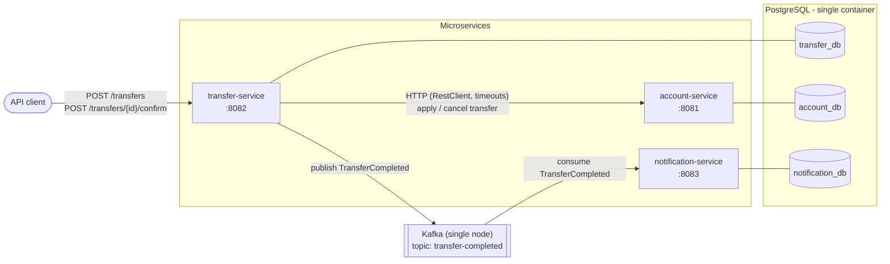
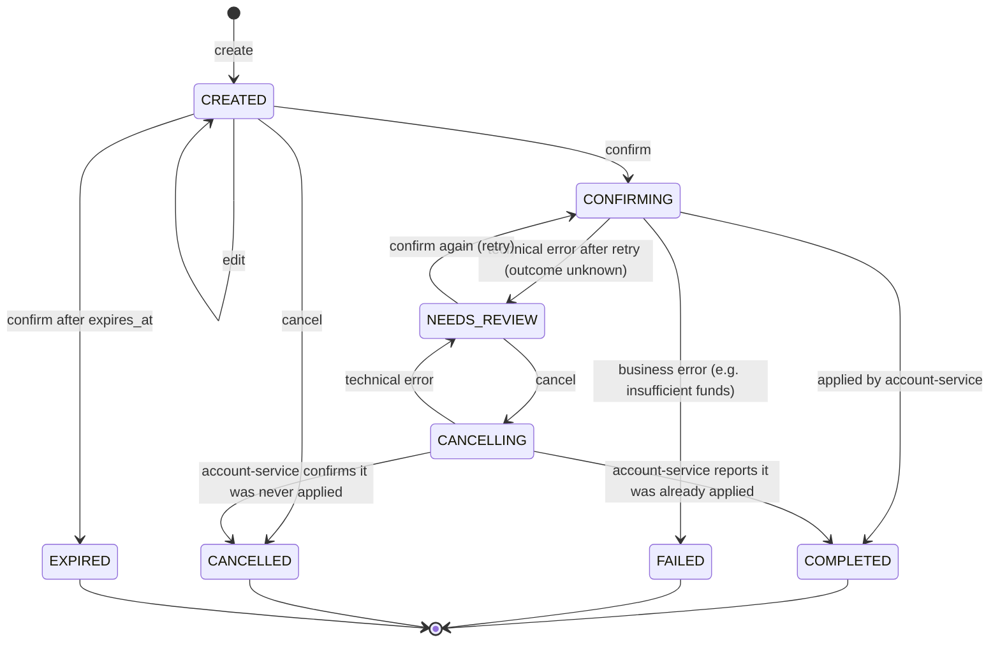
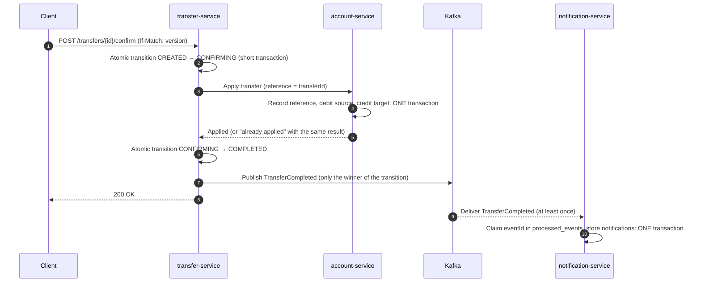

# Architecture

> Status: work in progress. This document describes the target architecture for `v0.1.0`.

## Overview

`payments-platform` is a small payments platform made of three Spring Boot microservices in a monorepo. Each service is an independent Maven project with its own database. Services talk to each other over synchronous HTTP (commands that need an immediate answer) and Kafka (facts that other services may react to later).



| Service | Port | Responsibility | Owns |
|---|---|---|---|
| account-service | 8081 | Accounts, balances and movements. Applies the debit and the credit of a transfer in one local database transaction, at most once per transfer reference. | `account_db` |
| transfer-service | 8082 | Public transfers API. Creates, edits, confirms and cancels transfers; makes confirmation idempotent; calls account-service and publishes `TransferCompleted`. | `transfer_db` |
| notification-service | 8083 | Consumes `TransferCompleted`, deduplicates by `eventId` and records notifications (database + log, no real e-mails). | `notification_db` |

## Transfer lifecycle: create, then confirm

A transfer is made in **two steps**:

1. **Create** (`POST /transfers`): the server stores the transfer in `CREATED` and returns its `transferId` (a UUID generated by the server). No money moves. While it is `CREATED` the transfer can be edited or cancelled.
2. **Confirm** (`POST /transfers/{id}/confirm`): money moves. This is the step that must be **atomic and idempotent**, and the `transferId` is its idempotency key.

This is similar to the create/confirm model of public payment APIs (for example, Stripe's PaymentIntents). Creation itself is not idempotent: a retried `POST /transfers` may leave an extra transfer in `CREATED`, which is harmless because it never moves money and it expires.

### Public API (transfer-service)

| Method and path | Description |
|---|---|
| `POST /transfers` | Create a transfer in `CREATED`. Returns `201`, the transfer and an `ETag` with its version. |
| `GET /transfers/{id}` | Current state of the transfer, with its `ETag`. |
| `PUT /transfers/{id}` | Edit a `CREATED` transfer. Requires `If-Match` with the current version. |
| `POST /transfers/{id}/confirm` | Confirm (or retry the confirmation of) a transfer. Requires `If-Match`. Idempotent. |
| `POST /transfers/{id}/cancel` | Cancel a transfer that is `CREATED` or whose outcome is unknown (`NEEDS_REVIEW`), only if it is guaranteed that no money moved. |

The exact responses for each state are in [idempotency.md](idempotency.md).

### Transfer states



`CONFIRMING` and `CANCELLING` are "in progress" states. They are claimed with an atomic state transition and protected by a 30-second lease (see [idempotency.md](idempotency.md)).

## Confirmation flow



1. The client confirms the transfer, sending the version it last saw in `If-Match`.
2. transfer-service claims the confirmation with a conditional update (`UPDATE ... SET status = 'CONFIRMING' WHERE id = ? AND status = 'CREATED' AND version = ?`) in its own short transaction. Exactly one concurrent request wins. The others wait for its result (polling, up to a maximum wait) and return it.
3. transfer-service calls account-service with `RestClient` (connect and read timeouts), using the `transferId` as the transfer reference. Technical errors (timeouts, connection errors, `5xx`) are retried once; business errors are never retried.
4. account-service, in a single database transaction, records the reference as applied, debits the source account and credits the target account. If anything fails, everything is rolled back and no movement is stored. A reference that was already applied returns the original result instead of applying it again.
5. transfer-service moves the transfer to `COMPLETED` (or `FAILED`) with another conditional update. Only the request that wins this transition publishes `TransferCompleted`, so each transfer produces a single event with a single `eventId`.
6. notification-service consumes the event and deduplicates it with the Idempotent Consumer pattern ([events.md](events.md)).

If the outcome stays unknown after the retry, the transfer moves to `NEEDS_REVIEW` and the client can retry the confirmation or cancel. A cancellation goes through account-service, which either blocks the reference (nothing was applied: `CANCELLED`) or reports that it was already applied (`COMPLETED`). A transfer is never marked as cancelled unless it is guaranteed that no money moved.

## Accounts and balances (account-service)

- **The balance is stored in the account** and updated in the **same transaction** as the movement that changes it, so it is always up to date. It is never recalculated on read.
- **Movements are an append-only ledger.** Every balance change is a movement, including the opening balance of a new account (a `DEPOSIT` movement). Each movement stores `balance_after`, like the balance column of a bank statement.
- **One single path changes the balance:** `Account.debit()` and `Account.credit()` update the balance and produce the movement together. There are no setters or loose `UPDATE` statements for the balance.
- **No negative balances, enforced in the domain** (`Account.debit` checks the funds). There is intentionally no database `CHECK` constraint, so that future features such as overdrafts only need a domain change.
- **Concurrency:** optimistic locking (`@Version`) on accounts. Two concurrent debits cannot both pass the funds check: one of them gets an optimistic lock failure and is retried with the fresh balance.
- **Deadlock avoidance:** accounts are always updated in the same order (by id). Otherwise a transfer A→B and a concurrent transfer B→A could lock the rows in opposite order.
- **At most once per transfer:** a `transfer_references` table with the reference as primary key records whether a reference was `APPLIED` or `CANCELLED`. A cancelled reference rejects any late attempt to apply it.

Draft schema (the final version will be the Flyway migrations):

```sql
accounts            (id UUID PK, currency CHAR(3), balance NUMERIC(19,4) NOT NULL,
                     version BIGINT, created_at, updated_at)
movements           (id UUID PK, account_id FK, transfer_reference UUID NULL,
                     type DEBIT|CREDIT|DEPOSIT, amount NUMERIC(19,4) CHECK (amount > 0),
                     balance_after NUMERIC(19,4), created_at)
transfer_references (reference UUID PK, status APPLIED|CANCELLED, created_at)
```

## Money

Money is a `Money` value object holding a `BigDecimal` amount and a currency.

- The amount is normalized to the currency's number of decimals (`setScale(..., RoundingMode.UNNECESSARY)`). An amount with more decimals than the currency allows (e.g. `10.005 EUR`) is rejected, never silently rounded. Because every `Money` has a normalized scale, equality works as expected (`BigDecimal.equals` would otherwise treat `1.0` and `1.00` as different).
- Operations between different currencies are rejected. A transfer requires the same currency in both accounts.
- Database: `NUMERIC(19,4)`. API and events: amounts as decimal strings (`"125.50"`), never JSON floating-point numbers.

## Service structure (light hexagonal architecture)

Every service uses the same three packages under its base package (`io.github.pr4m1.payments.account`, `.transfer`, `.notification`). Dependencies only point inwards: `infrastructure` → `application` → `domain`.

| Package | Contains | Must not depend on |
|---|---|---|
| `domain` | Aggregates with business rules (e.g. `Account.debit` checks the balance), value objects (`Money`), domain events, domain exceptions. Plain Java. | Spring, JPA, Kafka, `application`, `infrastructure` |
| `application` | Use cases that orchestrate the domain, and the ports (interfaces) they need, such as `AccountRepository` or `EventPublisher`. | `infrastructure` |
| `infrastructure` | Adapters: REST controllers and DTOs (`record`s), JPA entities and mappers, HTTP client, Kafka producer/consumer, Spring configuration. | — |

An ArchUnit test in each service enforces these rules.

## Decisions

| Decision | Why |
|---|---|
| Two-step transfers: create (editable) and confirm. The `transferId` generated at creation is the idempotency key of the confirmation. | Only the step that moves money needs to be idempotent, and the key is the transfer itself: no client-generated keys to store or expire. |
| Concurrent confirmations resolved with an atomic state transition; the losers poll for the winner's result. | Guaranteed by the database and safe with several instances, without holding a database connection during the HTTP call to account-service. |
| Edit and confirm protected by the transfer version (`If-Match`, `412` on mismatch). | A client never confirms an amount it has not seen. |
| Transfer atomicity lives in account-service, in one local database transaction (debit + credit). | Both accounts live in the same database, so a local ACID transaction gives all-or-nothing without a distributed protocol. |
| Unique transfer reference (`APPLIED` / `CANCELLED`) in account-service. | Retries can never move money twice, and cancellation is safe even when a previous call's outcome is unknown. |
| Automatic retry (once) only for technical errors; `NEEDS_REVIEW` when the outcome stays unknown. | Technical failures are often transient; business failures are definitive and retrying them is pointless. |
| 30-second lease on in-progress states. | A crash in the middle of a confirmation must not leave the transfer blocked forever. |
| Unconfirmed transfers expire (`expires_at`, checked when confirming). | Orphan transfers (e.g. from retried creations) cannot be confirmed later by mistake. No scheduled job needed. |
| No saga or compensation in this version. | With atomicity kept local there is nothing to compensate across services. |
| Stored balance, updated in the same transaction as each movement; movements with `balance_after`. | Reads are O(1), optimistic locking on the account row serializes debits, and the ledger allows auditing the balance. |
| No database `CHECK` on the balance. | The no-overdraft rule lives in the domain so that it can evolve without a migration. |
| Optimistic locking (`@Version`) on accounts, rows updated in id order. | Detects concurrent updates without long locks; a consistent update order avoids deadlocks. |
| `BigDecimal` in a normalized `Money` value object. | Exact decimal arithmetic, readable data, and correct equality thanks to the normalized scale. |
| Synchronous HTTP (`RestClient` with timeouts) between transfer-service and account-service. | The client needs to know whether the money moved; timeouts prevent a slow dependency from exhausting threads. |
| Kafka for `TransferCompleted`, with at-least-once delivery. | Notifications are a side effect that must not slow down or break the transfer. |
| Idempotent Consumer: a `processed_events` table claimed with `INSERT ... ON CONFLICT DO NOTHING`, in the same transaction as the notifications. | Deduplication is safe under concurrency and independent of how many notifications an event produces. |
| Schema changes only through Flyway migrations; never `ddl-auto=update`; never edit an applied migration. | The schema is versioned, reviewable and reproducible in every environment, including tests. |
| HTTP errors as `ProblemDetail` (RFC 9457) and input validation with Bean Validation. | A standard, machine-readable error format and declarative validation at the API boundary. |
| Database per service (one PostgreSQL container, one database each). | Services own their data and cannot couple through shared tables. |
| No shared library between services; each service defines its own event class. | Avoids lock-step releases. The shared contract is the documented JSON in [events.md](events.md). |
| Domain model separated from JPA entities (with mappers). | Business rules stay testable without a database and are not shaped by persistence concerns. |

## Limitations and next steps

- **Dual write between database and Kafka.** transfer-service commits `COMPLETED` and then publishes the event. If it crashes in between, the event is lost. Next step: the **transactional outbox** pattern (write the event to an outbox table in the same transaction and relay it to Kafka).
- **No saga.** If transfers ever span several services or databases (for example, accounts split across services or external payment rails), atomicity can no longer be local. Next step: an orchestrated **saga** with compensating actions.
- **Hot accounts.** Every transfer of an account updates the same row. An account with a very high transfer rate (e.g. a large merchant) would see many optimistic lock retries. Known solutions: sub-accounts or batched balance updates.
- **Reconciliation.** Balance and movements are kept consistent by design and verified by tests; there is no scheduled job that checks it in production. Next step: a reconciliation job that compares each balance with the sum of its movements and alerts on any difference (detects, never auto-fixes).
- **`processed_events` grows forever.** Next step: purge entries older than a safe window.
- **Security.** No authentication or authorization. Next step: OAuth2/JWT resource server, with signature and expiry validation, and service-to-service authentication.
- **Observability.** Only Spring Boot Actuator health endpoints. Next step: metrics with Prometheus and Grafana, distributed tracing.
- **Deployment.** Docker Compose only. Next step: Kubernetes manifests (or Helm) and a cloud deployment on AWS (e.g. RDS for PostgreSQL, MSK for Kafka).
- **Single-node infrastructure.** One PostgreSQL container and one Kafka broker: no replication or high availability.
