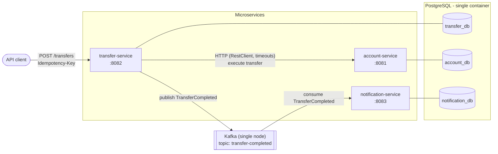
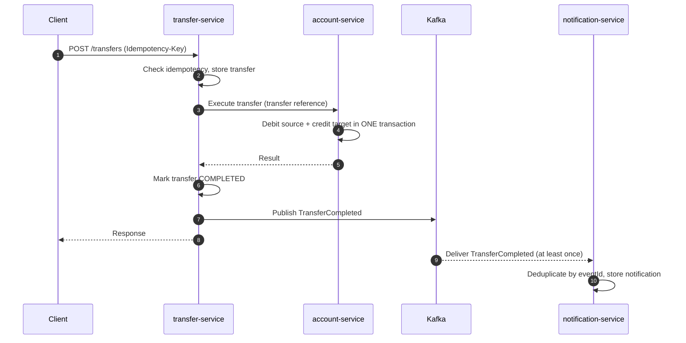

# Architecture

> Status: work in progress. This document describes the target architecture for `v0.1.0`.

## Overview

`payments-platform` is a small payments platform made of three Spring Boot microservices in a monorepo. Each service is an independent Maven project with its own database. Services talk to each other over synchronous HTTP (commands that need an immediate answer) and Kafka (facts that other services may react to later).

| Service | Port | Responsibility | Owns |
|---|---|---|---|
| account-service | 8081 | Accounts, balances and movements. Executes the debit and the credit of a transfer in one local database transaction. | `account_db` |
| transfer-service | 8082 | Public `POST /transfers` API. Enforces idempotency, stores the transfer and its status, calls account-service and publishes `TransferCompleted`. | `transfer_db` |
| notification-service | 8083 | Consumes `TransferCompleted`, deduplicates by `eventId` and records a notification (database + log, no real e-mails). | `notification_db` |

## Transfer flow

1. The client sends `POST /transfers` with an `Idempotency-Key` header and a body with source account, target account, amount and currency.
2. transfer-service validates the request (Bean Validation) and applies the idempotency rules described in [idempotency.md](idempotency.md) (repeated keys, concurrent requests, retries).
3. transfer-service stores the transfer with its initial status.
4. transfer-service calls account-service over HTTP using `RestClient` with connect and read timeouts, sending a unique transfer reference.
5. account-service debits the source account and credits the target account in a single database transaction. If anything fails (for example, insufficient funds or a failing credit), the whole transaction is rolled back and no movement is stored.
6. transfer-service marks the transfer as completed (or failed) and, on success, publishes a `TransferCompleted` event to Kafka (contract in [events.md](events.md)).
7. notification-service consumes the event, discards it if its `eventId` was already processed, and otherwise stores a notification and logs it.

## Service structure (light hexagonal architecture)

Every service uses the same three packages. Dependencies only point inwards: `infrastructure` → `application` → `domain`.

| Package | Contains | Must not depend on |
|---|---|---|
| `domain` | Aggregates with business rules (e.g. `Account.debit` checks the balance), value objects (`Money`), domain events, domain exceptions. Plain Java. | Spring, JPA, Kafka, `application`, `infrastructure` |
| `application` | Use cases that orchestrate the domain, and the ports (interfaces) they need, such as `AccountRepository` or `EventPublisher`. | `infrastructure` |
| `infrastructure` | Adapters: REST controllers and DTOs (`record`s), JPA entities and mappers, HTTP client, Kafka producer/consumer, Spring configuration. | — |

An ArchUnit test in each service enforces these rules.

## Decisions

| Decision | Why |
|---|---|
| Transfer atomicity lives in account-service, in one local database transaction (debit + credit). | Both accounts live in the same database, so a local ACID transaction gives all-or-nothing without a distributed protocol. |
| No saga or compensation in this version. | With atomicity kept local there is nothing to compensate across services; sagas add a lot of complexity for little value at this scope. |
| Optimistic locking (`@Version`) on accounts. | Detects concurrent updates to the same balance without holding database locks; conflicts are rare and can be retried. |
| Unique transfer reference in account-service. | A transfer cannot be applied twice even if transfer-service retries the HTTP call (for example, after a timeout). |
| Idempotent `POST /transfers` with an `Idempotency-Key` header. | Clients and networks retry; a retried payment must never move money twice. Rules in [idempotency.md](idempotency.md). |
| Synchronous HTTP (`RestClient` with timeouts) between transfer-service and account-service. | The client needs to know whether the money moved; timeouts prevent a slow dependency from exhausting threads. |
| Kafka for `TransferCompleted`, with at-least-once delivery. | Notifications are a side effect that must not slow down or break the transfer; Kafka decouples them. |
| Consumers deduplicate by `eventId` with a database unique constraint. | At-least-once delivery means duplicates will happen; the database constraint is the only check that is safe under concurrency. |
| Schema changes only through Flyway migrations; never `ddl-auto=update`; never edit an applied migration. | The schema is versioned, reviewable and reproducible in every environment, including tests. |
| HTTP errors as `ProblemDetail` (RFC 9457) and input validation with Bean Validation. | A standard, machine-readable error format and declarative validation at the API boundary. |
| Database per service (one PostgreSQL container, one database each). | Services own their data and cannot couple through shared tables; one container keeps the local setup light. |
| No shared library between services; each service defines its own event class. | Avoids lock-step releases. The shared contract is the documented JSON in [events.md](events.md). |
| Domain model separated from JPA entities (with mappers). | Business rules stay testable without a database and are not shaped by persistence concerns. |
| Code, commits and documentation in English. | The project targets an international audience. |

## Limitations and next steps

These are deliberately out of scope for `v0.1.0`:

- **Dual write between database and Kafka.** transfer-service commits the transfer and then publishes the event. If it crashes in between, the event is lost. Next step: the **transactional outbox** pattern (write the event to an outbox table in the same transaction and relay it to Kafka).
- **No saga.** If transfers ever span several services or databases (for example, accounts split across services or external payment rails), atomicity can no longer be local. Next step: an orchestrated **saga** with compensating actions.
- **Security.** No authentication or authorization. Next step: OAuth2/JWT resource server, with signature and expiry validation, and service-to-service authentication.
- **Observability.** Only Spring Boot Actuator health endpoints. Next step: metrics with Prometheus and Grafana, distributed tracing.
- **Deployment.** Docker Compose only. Next step: Kubernetes manifests (or Helm) and a cloud deployment on AWS (e.g. RDS for PostgreSQL, MSK for Kafka).
- **Single-node infrastructure.** One PostgreSQL container and one Kafka broker: no replication or high availability.
